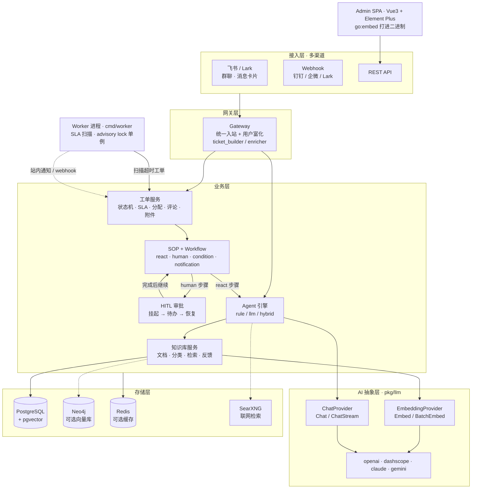

<div align="center">

# Husky · 企业级智能工单系统

**Go + Gin + GORM · RAG 知识库 · ReAct / SOP 工作流 · HITL 人在回路 · 飞书多渠道**

[](go.mod)
[](web/package.json)
[](docker-compose.yml)
[](#上游与许可证)
[](#关于这个仓库)

</div>

---

## 关于这个仓库

> **基于 `ilibx/husky` 的研究型 fork，不是我的原创项目。**
>
> - 上游：[**ilibx/husky**](https://github.com/ilibx/husky)（约 23 stars）
> - 本仓库在上游基础上做了**两处工程改造**：① 把 SLA 扫描从 API 进程里拆成独立 worker；② 补齐一套真能跑起来的 K8s 部署清单（见 [改动说明](#本仓库的改动)）
> - 起点意义：它是一个**可运行的 Agent 工程标本**，用来拆解「Chatbot 之外，Agent 怎么真正嵌进业务流程」

上游的架构与全部业务实现归原作者所有；我改动的是后台任务的生命周期管理、镜像构建链与部署编排。

---

## 本仓库的改动

上游把 SLA 扫描器 `SLAEscalator` 直接起在 `router.SetupRouter()` 里（一个 5 分钟的 ticker）。这在单实例下没问题，但**一扩副本就出事**：每个 API 实例各跑一份扫描器，同一条超时工单会被重复升级、重复发站内通知、重复打 webhook。

改动分两层：先把后台任务从 API 进程剥离，再让它能在 K8s 上安全地多副本运行。

**① 后台任务剥离**

| 文件 | 改动 |
|---|---|
| `cmd/worker/main.go` | 新增独立 worker 进程：`-interval` / `-once` / `-no-lock` / `-wait-lock`，启动即扫一轮，之后按周期执行；SIGTERM 优雅退出 |
| `pkg/pglock/pglock.go` | 抽出 PostgreSQL **advisory lock** 通用库（会话级锁，进程崩溃自动释放，无需建表）。由 worker 单例与 schema 迁移共用 |
| `deployments/Dockerfile.worker` | worker 专用镜像，跳过前端构建（省一次 `npm ci` + `vite build`） |
| `internal/ticket/sla.go` | 抽出纯函数 `DecideSLAAction`；新增 `RunOnce`；**修掉重复升级**：已 `breached` 的工单不再每轮重复通知 |
| `internal/ticket/sla_decision_test.go` | 13 个表驱动用例覆盖决策分支（含非法配置回退） |
| `internal/config/config.go` | 新增 `LoadWithFallback`：YAML 缺失时回退环境变量（镜像里不带 config.yaml 也能启动） |
| `internal/router/router.go` | 内嵌扫描器改为受 `DISABLE_INPROC_ESCALATOR=1` 控制，默认行为不变（向后兼容） |

**② 让它能在 K8s 上跑**

| 文件 | 改动 |
|---|---|
| `internal/router/router.go` | 新增 `/readyz`：查数据库连通性。`/health` 保持「只证明进程活着」，两者分开喂 liveness / readiness |
| `cmd/api/main.go` | AutoMigrate + 4 个 seed 全部包进 advisory lock，并支持 `SKIP_AUTOMIGRATE=1` 交给外部 Job |
| `deployments/Dockerfile` | 改成三段构建：**先构建前端**（原来直接 `go build`，`go:embed static/*` 找不到文件，构建必失败）→ 再编译 Go → 非 root 运行。同时 `golang:1.21` → `1.24` |
| `scripts/prepare-admin-embed.sh` | 把「Vite 产物去 `_` 前缀」的逻辑从 Makefile 抽成脚本，供 Makefile 与 Dockerfile 共用，避免两处漂移 |
| `.dockerignore` | 新增：否则 `COPY . .` 会把本地 `node_modules`、构建产物、`.git` 全塞进构建上下文 |
| `deployments/k8s/` | K8s 清单：base（API / worker / HPA / PDB / Ingress）+ overlays/dev（带 pgvector 的单副本 PG） |
| `scripts/validate-k8s.py` | 离线校验清单引用一致性（无集群环境可用） |
| `docker-compose.yml` | 去掉从未被使用的 `redis` 服务与 `./logs` 绑定挂载（代码不写日志文件，全部走 stdout） |

设计取舍：
- **默认行为不变**——不设环境变量时，API 仍自带内嵌扫描器，老部署无需任何改动。
- **worker 不执行 AutoMigrate**——schema 归 API 所有，两个进程同时迁移会打架，所以 compose 里让 worker 等 API 先启动，K8s 里用 initContainer 查 `to_regclass('public.tickets')` 等表就绪。
- **worker 不拉渠道客户端**——`SLAConfigService` 的 `eventHandler` 传 `nil`（内部已判空），worker 只负责站内通知 + 推送方式 + webhook；飞书等渠道消息仍由 API 侧 gateway 发送，避免同一个告警发两遍。

验证情况：
- ✅ `go build ./...`、`go vet` 通过
- ✅ `go test ./internal/ticket/ -run TestDecideSLAAction` 13/13 通过
- ✅ `kubectl kustomize` 渲染 base / dev overlay 通过；`scripts/validate-k8s.py` 全部检查通过
- ⚠️ **镜像未实机构建、清单未在真实集群 apply**（本机无 Docker / 无可用集群）。Dockerfile 与清单做的是静态校验，首次在集群里跑仍可能需要调（例如 StorageClass 名字、ingress 控制器差异）

---

## 30 秒理解

**它解决什么问题**：企业 IT 支持里，工单是「人肉流转 + 经验在老师傅脑子里」。Husky 想做的是——工单进来后，由 LLM 先查知识库、尝试直接回答；答不了再按 SOP 流转到人，人的每一步操作又被沉淀回知识库。

**技术上它特殊在哪**：市面上多数 Agent Demo 停在「对话框里调工具」。Husky 把 Agent 放进了**有状态、有 SLA、有权限、有审计的业务系统**里——这带来一堆 Demo 不会遇到的工程问题：ReAct 循环怎么防并发、人工介入怎么挂起和恢复、LLM 没配置时怎么优雅降级。**这些才是它的价值。**

---

## 架构一张图



---

## 为什么值得读（给 Go / Agent 工程同学）

如果你正在写「LLM 接进业务系统」的代码，这五个地方值得逐行看：

| # | 工程问题 | 它怎么解 | 读这里 |
|---|---|---|---|
| 1 | ReAct 循环在并发下会互相踩 | 用 `sync.Map` 对 step 加锁，避免同一工单多个 ReAct 循环同时跑 | `internal/agent/workflow_react.go` |
| 2 | 人工介入（HITL）怎么挂起再恢复 | SOP 的 `human` 步骤落库为待办，完成时通过 step lifecycle 推进整个 workflow | `internal/agent/step_lifecycle.go`<br/>`internal/agent/sop_handler.go` |
| 3 | LLM 未配置 / provider 不支持 Chat 时怎么办 | `NewChatService(provider)` 在不支持时返回 `nil`，调用方先判空降级，而不是运行时 panic（避免 leaky abstraction 的类型断言） | `pkg/llm/chat.go`<br/>`pkg/llm/provider.go` |
| 4 | 向量检索挂了不能整个问答崩 | pgvector 不可用时降级为 `ILIKE` 模糊匹配 | `internal/repository/vector_store.go`<br/>`internal/knowledge/service.go` |
| 5 | 前端怎么和 Go 单体一起发版 | `go:embed` 把 Vite 产物打进二进制；`Makefile` 里专门处理了 Go embed 会忽略 `_` 前缀文件的问题（重命名为 `x_` 并回写引用） | `Makefile`（`web-build` target）<br/>`internal/admin/admin.go` |

> 第 5 条那个 `_` 前缀处理，是这份代码里最容易被人忽略、也最能体现「真的发过版」的细节。

---

## 能力矩阵

| 领域 | 能力 |
|---|---|
| **工单** | 全生命周期状态机、SLA 超时升级、智能分配（轮询 / 负载 / 技能匹配）、评论 · 附件 · 协作 · 关注 · 满意度评价 · 工单关联 |
| **RAG 知识库** | 文档管理与分类、向量检索（pgvector / Neo4j）、批量导入导出、知识推荐、检索反馈闭环、无向量时 ILIKE 降级 |
| **Agent** | `rule`（自动派单 / 改状态 / 改优先级）、`llm`（检索 + 生成回复）、`hybrid`（先规则后 LLM），按 `ticket_created` / `ticket_updated` 事件触发 |
| **SOP / Workflow** | 四种步骤类型（`react` / `human` / `condition` / `notification`），工单创建时自动实例化流程 |
| **HITL** | 审批服务 + 待办任务 + 通知，人机交接可追溯 |
| **多渠道** | 飞书（群聊自动建群、消息卡片、自动回复、人工升级）、Webhook（Lark / 钉钉 / 企微）、REST API |
| **Admin** | Vue3 + Element Plus 单页后台，`go:embed` 内嵌进二进制；含工单 / 知识库 / Agent / SOP / Skill / MCP / 渠道 / 模型 / SLA / 系统管理 |
| **权限与审计** | JWT（含刷新）、RBAC、菜单权限、操作审计日志、LDAP 可选接入 |
| **AI 抽象** | 4 家 Provider（OpenAI / DashScope / Claude / Gemini）、Chat 与 Embedding 双接口分离、SearXNG 联网检索 |

---

## 快速开始

### 前置要求

- **Go 1.24+**（`go.mod` 声明 `go 1.24.0`，低于此版本直接编译失败）
- Docker + Docker Compose（起 PostgreSQL / Redis）
- Node 20+（仅构建 Admin UI 时需要）

### 路径 A：先让后端跑起来（最稳，4 条命令）

```bash
# 1. 起基础设施
docker compose up -d postgres redis

# 2. 准备配置（config.yaml 是主配置，.env 已弃用）
cp config.yaml config.local.yaml   # 按需改数据库地址与 LLM Key

# 3. 启动（内置 GORM AutoMigrate，开发环境无需手动迁移）
go run ./cmd/api --config config.local.yaml

# 4. 另开一个终端跑后台任务（SLA 扫描升级）
go run ./cmd/worker --config config.local.yaml --interval 60s
```

worker 常用参数：

```bash
go run ./cmd/worker -once      # 只扫一轮就退出，适合 cron 或本地调试
go run ./cmd/worker -no-lock   # 跳过 advisory lock（仅本地单机调试）
```

> 不跑 worker 也能用：API 默认自带内嵌扫描器。只有在 API 多副本部署时，才必须设
> `DISABLE_INPROC_ESCALATOR=1` 并改用 worker，否则每个副本都会各扫一遍。

验证：

```bash
curl http://localhost:8080/health
# {"status":"healthy"}
```

> 此时 `/admin` 打开是**空白页**——因为仓库里没有嵌入前端产物，必须先构建 SPA。见路径 B。

### 路径 B：连 Admin UI 一起跑

```bash
make web-build   # 构建 Vue SPA 并拷贝到 internal/admin/static
make build       # 编译 bin/husky-api 与 bin/husky-migrate
./bin/husky-api --config config.local.yaml
# 打开 http://localhost:8080/admin
```

前端独立开发（热更新）：

```bash
cd web && npm ci && npm run dev     # Vite dev server :5173
# 后端以 external 模式指向它：ADMIN_MODE=external ADMIN_URL=http://localhost:5173
```

### 默认管理员

首次启动时**仅在库里没有 admin 用户**的情况下自动创建：

| 字段 | 值 |
|---|---|
| 邮箱 | `admin@husky.local` |
| 密码 | `admin123` |
| 角色 | `admin` |

> ⚠️ 这是上游的默认值，任何非本机环境请第一时间改掉。

### 常用命令

```bash
make build-go     # 只编 Go 二进制，跳过前端（改后端时快很多）
make run          # go run ./cmd/api
make migrate      # 用 SQL 脚本迁移（生产推荐）
make test         # go test -v ./...
make test-coverage
```

---

## 部署到 Kubernetes

清单在 `deployments/k8s/`，kustomize 两段式：

```
deployments/k8s/
├── base/            # 应用本身：API / worker / HPA / PDB / Ingress / ConfigMap / Secret
└── overlays/dev/    # base + 一个仅供自测的单副本 Postgres（带 pgvector）
```

### 一键起（kind / minikube）

```bash
# 1. 构建镜像（API 镜像会先在容器内构建前端，无需本地 node）
docker build -f deployments/Dockerfile        -t ghcr.io/cugbtang/husky-api:dev    .
docker build -f deployments/Dockerfile.worker -t ghcr.io/cugbtang/husky-worker:dev .

# 2. 导入集群（kind 为例；minikube 用 minikube image load）
kind load docker-image ghcr.io/cugbtang/husky-api:dev ghcr.io/cugbtang/husky-worker:dev

# 3. 部署
kubectl apply -k deployments/k8s/overlays/dev

# 4. 观察
kubectl -n husky get pods -w
kubectl -n husky port-forward svc/husky-api 8080:80
# 打开 http://localhost:8080/admin，默认账号见 .env.example
```

可选前置：`metrics-server`（HPA 需要）、`ingress-nginx`（Ingress 需要）。缺了不影响服务启动，只是 HPA 显示 `<unknown>`、域名访问不生效。

### 清单里几个刻意的设计

| 设计 | 为什么这么做 |
|---|---|
| **liveness 查 `/health`，readiness 查 `/readyz`** | `/health` 只证明进程活着，`/readyz` 会 ping 数据库。如果 liveness 也查 DB，数据库抖一下 K8s 就会把所有 Pod 一起重启，把「暂时读不到数据」升级成「整个服务不可用」 |
| **AutoMigrate 包在 advisory lock 里** | HPA 扩容时新 Pod 也会跑迁移。GORM 的 AutoMigrate 是「先查有无再 CREATE/ALTER」，并发会撞 `duplicate key on pg_type` → 进程 Fatal → CrashLoop，表现为「一扩容就崩」。加锁后第二个副本排队，进来发现已是最新 schema 就空跑退出 |
| **worker 用 `-wait-lock` + `replicas: 2`** | 1 个持有锁在扫，另 1 个阻塞待命；持有者所在节点故障时待命者立刻接管。不加 `-wait-lock` 的话，待命副本会「退出→被重启→再退出」，变成重启风暴 |
| **worker 有 initContainer 等表存在** | worker 不跑迁移，直接启动会报表不存在。这里查 `to_regclass('public.tickets')`，而不是 `sleep 30` 猜时间 |
| **HPA 只挂 API，不挂 worker** | worker 是单例语义，扩副本不提升吞吐，只会让更多 Pod 排队等锁。这是「有状态后台任务」和「无状态服务」在扩容策略上的本质区别 |
| **连接池按「副本数 × pool ≤ PG max_connections」反推** | Postgres 默认 `max_connections=100`，HPA 上限 6 副本 × 25 = 150 就爆了。再往上扩的正解是前置 PgBouncer，不是继续调大数字 |
| **dev 的 Postgres 用 `pgvector/pgvector:pg16`** | `internal/model/knowledge.go` 有 `vector(1536)` 列，扩展不存在时 AutoMigrate 直接报 `type "vector" does not exist` → CrashLoop。官方 postgres 镜像不带这个扩展 |
| **PDB + topologySpreadConstraints** | 2 副本恰好落同一节点时，一次 `kubectl drain` 就会整服务中断。PDB 限制并发驱逐，spread 约束让副本尽量分散 |
| **非 root + 只读根文件系统 + drop ALL** | 镜像里 `adduser -u 10001`，清单里 `runAsUser: 10001` 必须对齐，否则 Pod 写临时文件失败。需要可写的地方单独挂 `emptyDir` 到 `/tmp` |

### 上线前必须改的三处

1. `base/secret.yaml` 全是占位符 —— 生产用 External Secrets / Sealed Secrets，或 `kubectl create secret` 覆盖后把它从 `kustomization.yaml` 里删掉
2. `base/configmap.yaml` 的 `DB_SSLMODE: "disable"` —— 生产改 `require` / `verify-full`
3. `base/ingress.yaml` 的 `husky.example.com` —— 换成真实域名并打开 TLS 段

生产还建议把迁移和发布解耦：`kubectl apply` 一个独立的 `Job` 跑迁移，并给 API 设 `SKIP_AUTOMIGRATE=1`，让 Pod 只负责起服务。

### 清单校验（无集群也能跑）

```bash
pip install pyyaml
python3 scripts/validate-k8s.py deployments/k8s/overlays/dev
```

`kubectl apply --dry-run=client` 在无集群环境会去拉 openapi 直接失败，所以这里自带一个离线检查器。它校验的是 kustomize 渲染后的**引用一致性**：Deployment selector 与 template labels 是否匹配、Service 的 targetPort 名字是否真的存在于容器端口、`envFrom` / `secretKeyRef` 指向的对象是否存在、HPA 指向的 workload 是否存在、PDB selector 是否匹配到 Pod、有没有漏 `requests`/`limits` 或非 root 上下文。

这些错误都不需要集群就能发现，但漏到集群里都得靠「Pod 起不来」来反推。

---

## ⚠️ 已知限制与踩坑（实测，非猜测）

用之前先知道这几件事，能省半天时间：

1. ~~**`docker compose up -d` 会失败**~~ → **已修复**
   上游 compose 里定义了 `worker` 服务，指向不存在的 `deployments/Dockerfile.worker`。本仓库已补上该镜像与 `cmd/worker` 入口，现在可以全量启动：

   ```bash
   docker compose up -d --build
   ```

   注意 `api` 与 `worker` 都从环境变量取配置（镜像内不含 `config.yaml`），要改数据库/LLM 配置请编辑 compose 的 `environment`。

2. **`/admin` 空白 = 前端没构建**
   `internal/admin/` 只有 `admin.go`，`static/` 目录是构建产物、不入库。
   - 用 Docker：镜像构建时会自动构建前端（`deployments/Dockerfile` 第一段）
   - 本地 `go run`：先执行 `make web-build`，否则只有 API 没有 UI

3. **数据库必须有 `pgvector` 扩展**
   `internal/model/knowledge.go` 里有 `vector(1536)` 列。如果用的是纯净的 `postgres` 镜像 / 没启用扩展的托管库，AutoMigrate 会直接失败（`type "vector" does not exist`），进程 Fatal 退出。
   - 自建：用 `pgvector/pgvector:pg16`（compose 与 K8s dev overlay 都是这个）
   - 云托管：确认该实例支持并已执行 `CREATE EXTENSION IF NOT EXISTS vector;`

4. **`pkg/cache` 里的 Redis 从未被实例化**
   全项目搜不到 `cache.NewRedis` / `cache.NewCache` 的调用点，`REDIS_HOST` 等环境变量是死配置。所以 compose 与 K8s 清单里都没有 Redis——不是漏了，是真不需要。要用缓存时再接。

5. **`.env.example` 已弃用**
   文件头自己写了「已弃用，请改用 config.yaml」。主配置是 `config.yaml`，环境变量只作为容器化部署的补充。

6. **`config.yaml` 里有明文数据库凭证**
   仓库内的 `config.yaml` 提交了内网地址与密码。**这是上游的卫生问题**，fork 使用前请改成自己的 localhost 配置，且不要把自己的真实凭证提交回来。

---

## 项目结构

```
husky/
├── cmd/
│   ├── api/                    # API 入口（含 AutoMigrate）
│   ├── migrate/                # 独立迁移工具（SQL 脚本）
│   └── worker/                 # 后台任务进程（SLA 扫描 + advisory lock 单例）
├── internal/
│   ├── admin/                  # Admin SPA 的 go:embed 入口（static/ 为构建产物）
│   ├── agent/                  # Agent 引擎 + SOP + Workflow + ReAct 循环 + 审批
│   ├── channel/                # 渠道抽象与管理
│   │   └── feishu/             # 飞书 SDK（client / message / chat / user）
│   ├── gateway/                # 统一入站网关 + 用户富化 + 工单构建
│   ├── knowledge/              # 知识库服务 + 反馈 + 导入导出
│   ├── ticket/                 # 工单服务（状态机 / SLA / 分配 / 评论 / 标签 / 满意度）
│   ├── intent/                 # 意图识别
│   ├── ldap/                   # LDAP 同步（可选）
│   ├── middleware/             # 认证 / RBAC / CORS / 限流
│   ├── model/                  # GORM 数据模型
│   ├── repository/             # 数据访问层（含 vector_store）
│   ├── router/                 # 路由注册与依赖注入
│   ├── service/                # 通用业务服务
│   └── config/                 # 配置加载（yaml + env）
├── pkg/                        # 可复用公共库
│   ├── llm/                    # ChatProvider / EmbeddingProvider + 4 家实现
│   ├── vectorstore/            # pgvector / Neo4j + factory
│   ├── websearch/              # SearXNG 检索
│   ├── pglock/                 # PostgreSQL advisory lock（worker 单例 / 迁移串行化）
│   ├── cache/                  # Redis / Noop（当前未被实例化，见下方说明）
│   ├── errors/                 # 错误封装 + HTTP 响应
│   ├── httputil/               # 分页 / 统一响应
│   ├── logger/                 # zap 封装
│   └── validator/              # 参数校验
├── web/                        # Vue3 + Element Plus 前端源码
├── scripts/
│   ├── migrations/             # SQL 迁移脚本
│   ├── prepare-admin-embed.sh  # Vite 产物 → go:embed 目录（Makefile 与 Dockerfile 共用）
│   └── validate-k8s.py         # 离线校验 K8s 清单引用一致性
├── deployments/
│   ├── Dockerfile              # API 镜像（三段构建：前端 → Go → 非 root 运行）
│   ├── Dockerfile.worker       # worker 镜像（跳过前端）
│   └── k8s/                    # base + overlays/dev
├── docs/                       # architecture / basic / channels/feishu
├── docker-compose.yml
├── config.yaml
└── Makefile
```

---

## 核心设计（上游设计，非我实现）

### SOP 的四种步骤

| 步骤 | 行为 |
|---|---|
| `react` | LLM 驱动的 ReAct 循环：思考 → 决策 → 执行工具，最多 10 轮，历史滑动窗口保留最近 5 轮 |
| `human` | 人工介入，落库为待办步骤，可配置超时（默认 24h） |
| `condition` | 按工单字段（status / priority / assignee）判断是否跳过 |
| `notification` | 向指定用户推送通知 |

`react` 步骤的可用工具：`search_kb` · `reply_user` · `update_ticket` · `complete` · `fail`。

### Agent 三类

- `rule`：执行预设动作（auto_assign / set_status / set_priority），不调 LLM
- `llm`：检索知识库 → 生成回复 → 落为内部评论
- `hybrid`：先跑规则，再跑 LLM

### 为什么 Chat 与 Embedding 要拆开

`EmbeddingProvider` 和 `ChatProvider` 是两个独立接口。原因很实际：DashScope 早期只提供 Embedding 不提供 Chat，如果强行合成一个 `LLMProvider`，调用方就得靠类型断言判断能力，属于 leaky abstraction。拆开后 `NewChatService(provider)` 在能力缺失时直接返回 `nil`，调用方显式降级。

---

## 配置

主配置文件 `config.yaml`，支持 `--config` 指定路径。

### LLM Provider

`pkg/llm` 实现四家，通过 provider 名切换：

| Provider | 常量值 | Chat | Embedding |
|---|---|---|---|
| OpenAI | `openai` | ✅ | ✅ |
| DashScope（阿里百炼） | `dashscope` | — | ✅ |
| Claude | `claude` | ✅ | — |
| Gemini | `gemini` | ✅ | — |

任意 OpenAI 兼容端点（vLLM / Ollama / One-API）都可以用 `openai` + 自定义 `base_url` 接入。

### 向量库

| provider | 说明 |
|---|---|
| `postgresql`（默认） | 复用 GORM 连接的 pgvector |
| `neo4j` | 独立图数据库向量索引 |

### 关键配置项

| 配置 | 说明 | 默认 |
|---|---|---|
| `server.port` | HTTP 端口 | `8080` |
| `server.base_path` | 子路径部署（如 `/husky`） | `""` |
| `database.*` | PostgreSQL 连接 | — |
| `cache.enable` | 是否启用 Redis | `false` |
| `jwt.secret` | JWT 签名密钥（**生产必改**） | 占位值 |
| `ldap.enable` | LDAP 接入 | `false` |
| `storage.provider` | 知识库附件存储：`local` / `s3` / `ftp` / `lark` | `local` |
| `ADMIN_MODE` | `embedded` / `external` | `embedded` |

---

## API 概要

完整文档见 [`docs/basic.md`](docs/basic.md)，架构细节见 [`docs/architecture.md`](docs/architecture.md)。

| 分组 | 代表端点 |
|---|---|
| 认证 | `POST /api/v1/auth/login` · `/refresh` |
| 工单 | `GET/POST /api/v1/tickets` · `/tickets/:id/{assign,claim,status,rate,comments,attachments,tags,relations}` |
| 知识库 | `POST /api/v1/knowledge/search` · `/knowledge/{import,export,recommend}` |
| Agent | `GET/POST /api/v1/agents` |
| SOP | `GET/POST /api/v1/sop` |
| Workflow | `GET /api/v1/workflows` · `POST /workflows/steps/:stepId/complete` · `GET /workflows/tasks` |
| 渠道 | `/api/v1/channels` · `/channel-users` · `/channel-groups` · `/channels/:channel/bot-config` |
| 扩展 | `/api/v1/skills` · `/api/v1/mcps`（MCP 服务管理） |
| 回调 | `POST /webhooks/{lark,dingtalk,wecom}` |
| 运维 | `GET /health`（进程存活）· `GET /readyz`（含 DB 连通性）· `GET /status` |

---

## 测试

```bash
go test ./... -v
go test -coverprofile=coverage.out ./...
```

当前测试覆盖 4 个包：`internal/model`、`internal/service`（auth）、`internal/ticket`（service + SLA 决策）。**整体覆盖率仍然不高**，这是上游现状。

本仓库新增的部分有单测兜底：

```bash
go test ./internal/ticket/ -run TestDecideSLAAction -v   # 13 个用例
```

---

## 如果我要继续动它（Roadmap）

这是我 fork 它的真实意图，按优先级：

- [x] **补齐 worker**：`cmd/worker` + `deployments/Dockerfile.worker` 已落地，`docker compose up` 可起全栈
- [x] **SLA 决策测试**：`DecideSLAAction` 抽出纯函数 + 13 个用例
- [x] **容器化改造**：`deployments/k8s/`（Deployment / HPA / PDB / Ingress / ConfigMap / Secret + dev overlay）
- [x] **探针拆分**：`/health` 与 `/readyz` 分离，迁移并发问题用 advisory lock 解决
- [ ] **补测试**：ReAct 循环与 SOP 状态推进仍是最该被测试保护的部分，目前零覆盖
- [ ] **接本地推理**：把 provider 指向 vLLM / Ollama，验证「私有化部署 + 本地模型」这条链路
- [ ] **可观测性**：接入 Prometheus 指标（工单量、ReAct 轮次、LLM 延迟与 token 成本）

---

## 上游与许可证

- 上游项目：[**ilibx/husky**](https://github.com/ilibx/husky)，所有架构设计与业务实现归属原作者
- 本仓库：学习研究用途，在上游 `master` 基础上做了后台任务剥离与 K8s 部署改造（见 [本仓库的改动](#本仓库的改动)）
- **许可证**：上游仓库**未声明开源许可证**（API 返回 license 为 null）。严格来说，未声明许可证的代码默认保留所有权利，**不建议商用或再分发**。如需商用，请联系上游作者取得授权。

## 致谢

Gin · GORM · pgvector · Element Plus · Vue 3 · kustomize
