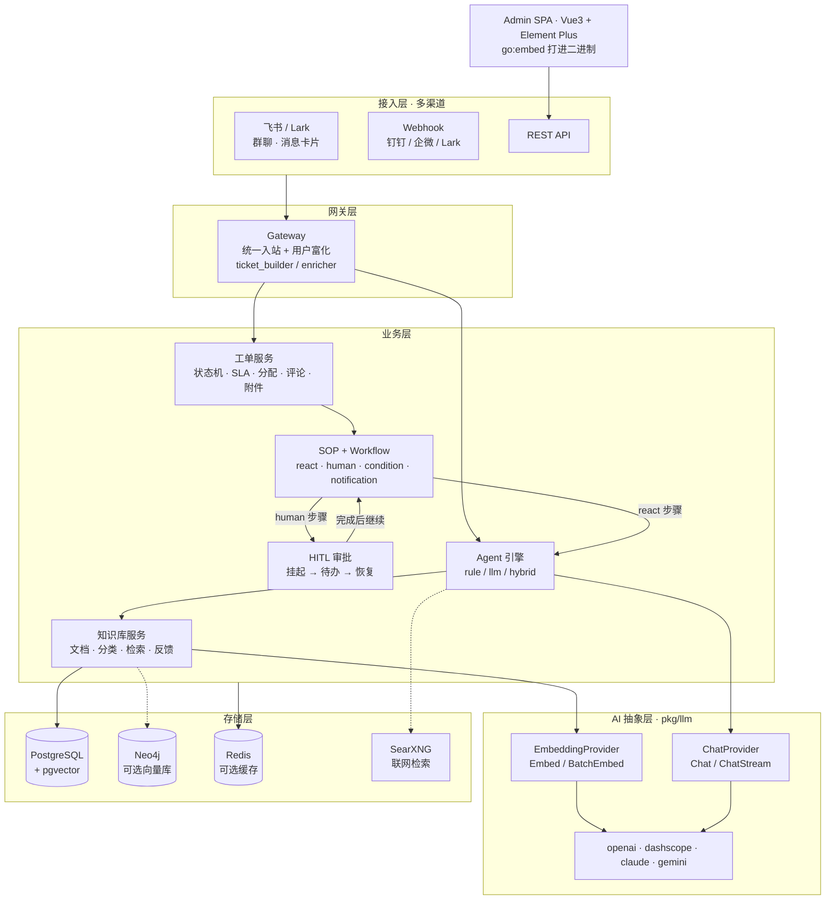

<div align="center">

# Husky · 企业级智能工单系统

**Go + Gin + GORM · RAG 知识库 · ReAct / SOP 工作流 · HITL 人在回路 · 飞书多渠道**

[](go.mod)
[](web/package.json)
[](docker-compose.yml)
[](#上游与许可证)
[](#关于这个仓库)

</div>

---

## 关于这个仓库

> **这是 `ilibx/husky` 的研究型 fork，不是我的原创项目。**
>
> - 上游：[**ilibx/husky**](https://github.com/ilibx/husky)（约 23 stars）
> - 同步状态：与上游 `master` **完全一致**（`ahead_by=0, behind_by=0`），本仓库**未做任何本地修改**
> - 这里存在的意义：作为一个**可运行的 Agent 工程标本**，用来拆解「Chatbot 之外，Agent 怎么真正嵌进业务流程」

我把它当作学习材料，而不是作品。这个定位写在最前面，避免任何误解。

---

## 30 秒理解

**它解决什么问题**：企业 IT 支持里，工单是「人肉流转 + 经验在老师傅脑子里」。Husky 想做的是——工单进来后，由 LLM 先查知识库、尝试直接回答；答不了再按 SOP 流转到人，人的每一步操作又被沉淀回知识库。

**技术上它特殊在哪**：市面上多数 Agent Demo 停在「对话框里调工具」。Husky 把 Agent 放进了**有状态、有 SLA、有权限、有审计的业务系统**里——这带来一堆 Demo 不会遇到的工程问题：ReAct 循环怎么防并发、人工介入怎么挂起和恢复、LLM 没配置时怎么优雅降级。**这些才是它的价值。**

---

## 架构一张图



---

## 为什么值得读（给 Go / Agent 工程同学）

如果你正在写「LLM 接进业务系统」的代码，这五个地方值得逐行看：

| # | 工程问题 | 它怎么解 | 读这里 |
|---|---|---|---|
| 1 | ReAct 循环在并发下会互相踩 | 用 `sync.Map` 对 step 加锁，避免同一工单多个 ReAct 循环同时跑 | `internal/agent/workflow_react.go` |
| 2 | 人工介入（HITL）怎么挂起再恢复 | SOP 的 `human` 步骤落库为待办，完成时通过 step lifecycle 推进整个 workflow | `internal/agent/step_lifecycle.go`<br/>`internal/agent/sop_handler.go` |
| 3 | LLM 未配置 / provider 不支持 Chat 时怎么办 | `NewChatService(provider)` 在不支持时返回 `nil`，调用方先判空降级，而不是运行时 panic（避免 leaky abstraction 的类型断言） | `pkg/llm/chat.go`<br/>`pkg/llm/provider.go` |
| 4 | 向量检索挂了不能整个问答崩 | pgvector 不可用时降级为 `ILIKE` 模糊匹配 | `internal/repository/vector_store.go`<br/>`internal/knowledge/service.go` |
| 5 | 前端怎么和 Go 单体一起发版 | `go:embed` 把 Vite 产物打进二进制；`Makefile` 里专门处理了 Go embed 会忽略 `_` 前缀文件的问题（重命名为 `x_` 并回写引用） | `Makefile`（`web-build` target）<br/>`internal/admin/admin.go` |

> 第 5 条那个 `_` 前缀处理，是这份代码里最容易被人忽略、也最能体现「真的发过版」的细节。

---

## 能力矩阵

| 领域 | 能力 |
|---|---|
| **工单** | 全生命周期状态机、SLA 超时升级、智能分配（轮询 / 负载 / 技能匹配）、评论 · 附件 · 协作 · 关注 · 满意度评价 · 工单关联 |
| **RAG 知识库** | 文档管理与分类、向量检索（pgvector / Neo4j）、批量导入导出、知识推荐、检索反馈闭环、无向量时 ILIKE 降级 |
| **Agent** | `rule`（自动派单 / 改状态 / 改优先级）、`llm`（检索 + 生成回复）、`hybrid`（先规则后 LLM），按 `ticket_created` / `ticket_updated` 事件触发 |
| **SOP / Workflow** | 四种步骤类型（`react` / `human` / `condition` / `notification`），工单创建时自动实例化流程 |
| **HITL** | 审批服务 + 待办任务 + 通知，人机交接可追溯 |
| **多渠道** | 飞书（群聊自动建群、消息卡片、自动回复、人工升级）、Webhook（Lark / 钉钉 / 企微）、REST API |
| **Admin** | Vue3 + Element Plus 单页后台，`go:embed` 内嵌进二进制；含工单 / 知识库 / Agent / SOP / Skill / MCP / 渠道 / 模型 / SLA / 系统管理 |
| **权限与审计** | JWT（含刷新）、RBAC、菜单权限、操作审计日志、LDAP 可选接入 |
| **AI 抽象** | 4 家 Provider（OpenAI / DashScope / Claude / Gemini）、Chat 与 Embedding 双接口分离、SearXNG 联网检索 |

---

## 快速开始

### 前置要求

- **Go 1.24+**（`go.mod` 声明 `go 1.24.0`，低于此版本直接编译失败）
- Docker + Docker Compose（起 PostgreSQL / Redis）
- Node 20+（仅构建 Admin UI 时需要）

### 路径 A：先让后端跑起来（最稳，3 条命令）

```bash
# 1. 只起基础设施 —— 不要用 docker compose up 全量启动（见下方「已知限制」）
docker compose up -d postgres redis

# 2. 准备配置（config.yaml 是主配置，.env 已弃用）
cp config.yaml config.local.yaml   # 按需改数据库地址与 LLM Key

# 3. 启动（内置 GORM AutoMigrate，开发环境无需手动迁移）
go run ./cmd/api --config config.local.yaml
```

验证：

```bash
curl http://localhost:8080/health
# {"status":"healthy"}
```

> 此时 `/admin` 打开是**空白页**——因为仓库里没有嵌入前端产物，必须先构建 SPA。见路径 B。

### 路径 B：连 Admin UI 一起跑

```bash
make web-build   # 构建 Vue SPA 并拷贝到 internal/admin/static
make build       # 编译 bin/husky-api 与 bin/husky-migrate
./bin/husky-api --config config.local.yaml
# 打开 http://localhost:8080/admin
```

前端独立开发（热更新）：

```bash
cd web && npm ci && npm run dev     # Vite dev server :5173
# 后端以 external 模式指向它：ADMIN_MODE=external ADMIN_URL=http://localhost:5173
```

### 默认管理员

首次启动时**仅在库里没有 admin 用户**的情况下自动创建：

| 字段 | 值 |
|---|---|
| 邮箱 | `admin@husky.local` |
| 密码 | `admin123` |
| 角色 | `admin` |

> ⚠️ 这是上游的默认值，任何非本机环境请第一时间改掉。

### 常用命令

```bash
make build-go     # 只编 Go 二进制，跳过前端（改后端时快很多）
make run          # go run ./cmd/api
make migrate      # 用 SQL 脚本迁移（生产推荐）
make test         # go test -v ./...
make test-coverage
```

---

## ⚠️ 已知限制与踩坑（实测，非猜测）

用之前先知道这四件事，能省半天时间：

1. **`docker compose up -d` 会失败**
   `docker-compose.yml` 里定义了 `worker` 服务，指向 `deployments/Dockerfile.worker`，但该文件不存在；`cmd/` 下也只有 `api` 和 `migrate`，**没有 worker 入口**。这是上游遗留的半成品。
   → 起基础设施用 `docker compose up -d postgres redis`；起应用用 `api` 服务或本地 `go run`。

2. **`/admin` 空白 = 前端没构建**
   `internal/admin/` 只有 `admin.go`，`static/` 目录是 `make web-build` 的产物、不入库。不构建就没有 UI。

3. **`.env.example` 已弃用**
   文件头自己写了「已弃用，请改用 config.yaml」。主配置是 `config.yaml`，环境变量只作为容器化部署的补充。

4. **`config.yaml` 里有明文数据库凭证**
   仓库内的 `config.yaml` 提交了内网地址与密码。**这是上游的卫生问题**，fork 使用前请改成自己的 localhost 配置，且不要把自己的真实凭证提交回来。

---

## 项目结构

```
husky/
├── cmd/
│   ├── api/                    # API 入口（含 AutoMigrate）
│   └── migrate/                # 独立迁移工具（SQL 脚本）
├── internal/
│   ├── admin/                  # Admin SPA 的 go:embed 入口（static/ 为构建产物）
│   ├── agent/                  # Agent 引擎 + SOP + Workflow + ReAct 循环 + 审批
│   ├── channel/                # 渠道抽象与管理
│   │   └── feishu/             # 飞书 SDK（client / message / chat / user）
│   ├── gateway/                # 统一入站网关 + 用户富化 + 工单构建
│   ├── knowledge/              # 知识库服务 + 反馈 + 导入导出
│   ├── ticket/                 # 工单服务（状态机 / SLA / 分配 / 评论 / 标签 / 满意度）
│   ├── intent/                 # 意图识别
│   ├── ldap/                   # LDAP 同步（可选）
│   ├── middleware/             # 认证 / RBAC / CORS / 限流
│   ├── model/                  # GORM 数据模型
│   ├── repository/             # 数据访问层（含 vector_store）
│   ├── router/                 # 路由注册与依赖注入
│   ├── service/                # 通用业务服务
│   └── config/                 # 配置加载（yaml + env）
├── pkg/                        # 可复用公共库
│   ├── llm/                    # ChatProvider / EmbeddingProvider + 4 家实现
│   ├── vectorstore/            # pgvector / Neo4j + factory
│   ├── websearch/              # SearXNG 检索
│   ├── cache/                  # Redis / Noop
│   ├── errors/                 # 错误封装 + HTTP 响应
│   ├── httputil/               # 分页 / 统一响应
│   ├── logger/                 # zap 封装
│   └── validator/              # 参数校验
├── web/                        # Vue3 + Element Plus 前端源码
├── scripts/migrations/         # SQL 迁移脚本
├── docs/                       # architecture / basic / channels/feishu
├── deployments/Dockerfile      # API 镜像（注意：缺 Dockerfile.worker）
├── docker-compose.yml
├── config.yaml
└── Makefile
```

---

## 核心设计（上游设计，非我实现）

### SOP 的四种步骤

| 步骤 | 行为 |
|---|---|
| `react` | LLM 驱动的 ReAct 循环：思考 → 决策 → 执行工具，最多 10 轮，历史滑动窗口保留最近 5 轮 |
| `human` | 人工介入，落库为待办步骤，可配置超时（默认 24h） |
| `condition` | 按工单字段（status / priority / assignee）判断是否跳过 |
| `notification` | 向指定用户推送通知 |

`react` 步骤的可用工具：`search_kb` · `reply_user` · `update_ticket` · `complete` · `fail`。

### Agent 三类

- `rule`：执行预设动作（auto_assign / set_status / set_priority），不调 LLM
- `llm`：检索知识库 → 生成回复 → 落为内部评论
- `hybrid`：先跑规则，再跑 LLM

### 为什么 Chat 与 Embedding 要拆开

`EmbeddingProvider` 和 `ChatProvider` 是两个独立接口。原因很实际：DashScope 早期只提供 Embedding 不提供 Chat，如果强行合成一个 `LLMProvider`，调用方就得靠类型断言判断能力，属于 leaky abstraction。拆开后 `NewChatService(provider)` 在能力缺失时直接返回 `nil`，调用方显式降级。

---

## 配置

主配置文件 `config.yaml`，支持 `--config` 指定路径。

### LLM Provider

`pkg/llm` 实现四家，通过 provider 名切换：

| Provider | 常量值 | Chat | Embedding |
|---|---|---|---|
| OpenAI | `openai` | ✅ | ✅ |
| DashScope（阿里百炼） | `dashscope` | — | ✅ |
| Claude | `claude` | ✅ | — |
| Gemini | `gemini` | ✅ | — |

任意 OpenAI 兼容端点（vLLM / Ollama / One-API）都可以用 `openai` + 自定义 `base_url` 接入。

### 向量库

| provider | 说明 |
|---|---|
| `postgresql`（默认） | 复用 GORM 连接的 pgvector |
| `neo4j` | 独立图数据库向量索引 |

### 关键配置项

| 配置 | 说明 | 默认 |
|---|---|---|
| `server.port` | HTTP 端口 | `8080` |
| `server.base_path` | 子路径部署（如 `/husky`） | `""` |
| `database.*` | PostgreSQL 连接 | — |
| `cache.enable` | 是否启用 Redis | `false` |
| `jwt.secret` | JWT 签名密钥（**生产必改**） | 占位值 |
| `ldap.enable` | LDAP 接入 | `false` |
| `storage.provider` | 知识库附件存储：`local` / `s3` / `ftp` / `lark` | `local` |
| `ADMIN_MODE` | `embedded` / `external` | `embedded` |

---

## API 概要

完整文档见 [`docs/basic.md`](docs/basic.md)，架构细节见 [`docs/architecture.md`](docs/architecture.md)。

| 分组 | 代表端点 |
|---|---|
| 认证 | `POST /api/v1/auth/login` · `/refresh` |
| 工单 | `GET/POST /api/v1/tickets` · `/tickets/:id/{assign,claim,status,rate,comments,attachments,tags,relations}` |
| 知识库 | `POST /api/v1/knowledge/search` · `/knowledge/{import,export,recommend}` |
| Agent | `GET/POST /api/v1/agents` |
| SOP | `GET/POST /api/v1/sop` |
| Workflow | `GET /api/v1/workflows` · `POST /workflows/steps/:stepId/complete` · `GET /workflows/tasks` |
| 渠道 | `/api/v1/channels` · `/channel-users` · `/channel-groups` · `/channels/:channel/bot-config` |
| 扩展 | `/api/v1/skills` · `/api/v1/mcps`（MCP 服务管理） |
| 回调 | `POST /webhooks/{lark,dingtalk,wecom}` |
| 运维 | `GET /health` |

---

## 测试

```bash
go test ./... -v
go test -coverprofile=coverage.out ./...
```

当前测试覆盖 3 个包：`internal/model`、`internal/service`（auth）、`internal/ticket`（service）。**覆盖率不高**，这是上游现状——也是 fork 下来做实验最合适的切入点。

---

## 如果我要继续动它（Roadmap）

这是我 fork 它的真实意图，按优先级：

- [ ] **补测试**：ReAct 循环与 SOP 状态推进是最该被测试保护的部分，目前零覆盖
- [ ] **补齐 worker**：把 `cmd/worker` + `deployments/Dockerfile.worker` 落地，让 `docker compose up` 能一把起全栈
- [ ] **容器化改造**：K8s 部署清单（Deployment / HPA / ConfigMap / Secret），顺带练 GPU 无关的编排基本功
- [ ] **接本地推理**：把 provider 指向 vLLM / Ollama，验证「私有化部署 + 本地模型」这条链路
- [ ] **可观测性**：接入 Prometheus 指标（工单量、ReAct 轮次、LLM 延迟与 token 成本）

---

## 上游与许可证

- 上游项目：[**ilibx/husky**](https://github.com/ilibx/husky)，所有架构设计与实现归属原作者
- 本仓库：仅作学习研究使用，与上游 `master` 同步，无本地改动
- **许可证**：上游仓库**未声明开源许可证**（API 返回 license 为 null）。严格来说，未声明许可证的代码默认保留所有权利，**不建议商用或再分发**。如需商用，请联系上游作者取得授权。

## 致谢

Gin · GORM · pgvector · Redis · Element Plus · Vue 3
